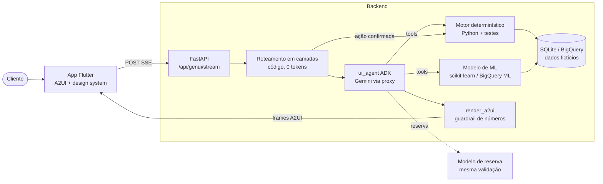

# Padrões de arquitetura campeões, mapeados neste repo

Use na fase 3. Cada padrão diz o que é, por que pontua e onde entra no repo. Antes de editar `backend/**` leia `.claude/rules/backend-adk2.md`; antes de `mobile/**`, `.claude/rules/flutter-genui.md`.

## O que o repo já tem (não reconstruir)

| Peça | Onde |
|---|---|
| Fluxo ADK: `prepare_input` (código) → `ui_agent` (LLM + tools) → `render_a2ui` (código, valida o `UiResponse`) | `backend/app/modules/assistant/workflow.py` |
| Instrução e few-shots do agente | `build_instruction()` em `backend/app/modules/assistant/agent.py` |
| Módulo de exemplo com tools, service, seed, router | `backend/app/modules/records/` |
| Gerador de módulo nos dois lados | `scripts/new_module.sh <nome>` (`--backend-only` / `--mobile-only`) |
| Widgets A2UI: `SummaryKpiCard`, `ActionChecklistCard`, `ApprovalConfirmationCard` (ação `approval_decided`), `InfoListCard`, `DynamicFormCard` | `contracts/README.md` |
| Provedor do modelo, retry e reserva (`LLM_PROVIDER=gemini\|apigee\|openai`, `LLM_FALLBACK_MODELS`) | `backend/app/core/llm.py`, ADR 0004 |
| Modo demo sem rede (`DEMO_MODE=record\|replay`) | `backend/app/modules/assistant/demo.py` |
| Container para Cloud Run / jurado | `backend/Containerfile`, `compose.yaml` |
| Marca a partir do Figma | `/boot-theme` |

Hoje uma ação do app (ex.: `approval_decided`) volta como mensagem e passa pelo LLM. Para ação com efeito, use o padrão 4.

## Padrões

### 1. Contrato do agente (escreva antes de codar)

Uma tabela em `docs/hackathon/02-arquitetura.md`: o que o agente **pode** (entender, consultar, simular, propor, explicar), o que **não pode** (calcular, prometer, recomendar produto específico, executar sem confirmação, usar dado real) e **quando encaminha** para humano. Vira regra em `build_instruction()` e teste.

Em investimentos, o contrato cobre regulação: plano, alocação ou intervenção em venda é recomendação e esbarra em suitability (Resolução CVM 30). Saídas: tratar como simulação educativa com o perfil de suitability como entrada, ou encaminhar para assessor. A banca pergunta isso.

### 2. Motor determinístico: o código calcula, o LLM explica

- Todo número, elegibilidade e regra sai de Python puro em `backend/app/modules/<dominio>/service.py` (ou `engine.py`), com testes unitários em `backend/tests/modules/<dominio>/`.
- Premissas (taxas, limites, pesos) num único arquivo (`policies.py`), para trocar sem mexer no motor.
- As tools em `tools.py` chamam o motor e devolvem resposta enxuta (`model_dump(mode="json")`), nunca a tabela inteira.
- Por que pontua: exatidão, auditabilidade, testes visíveis (critério técnico de 30-50%).

### 3. Guardrail de números

- Todo número que aparece no texto ou nos widgets precisa existir nos resultados das tools do turno ou no que o usuário disse.
- Número extraído de imagem/PDF pelo modelo também é número vindo do LLM. Mostre a extração num `DynamicFormCard` pré-preenchido para o usuário confirmar antes de qualquer cálculo, e confira em código o que for checável (soma das posições contra o total).
- Onde: no nó `render_a2ui` (código, já valida o `UiResponse`) ou num `after_model_callback` do agente. Guarde os resultados das tools no state da sessão para comparar.
- Falhou: não mostra o número; responde com texto seguro e oferece encaminhar para humano. Registre o bloqueio no log, não na tela.
- A reserva de modelo (`LLM_FALLBACK_MODELS`) passa pelo mesmo `render_a2ui`, então herda a mesma validação. Diga isso na arquitetura: é o padrão "reserva com a mesma barra" que os jurados Google destacam.

### 4. Humano no circuito com execução determinística

- O agente propõe com `ApprovalConfirmationCard` (números vindos do motor, nunca do texto do modelo).
- A execução não passa pelo LLM: um nó de código no workflow reconhece a ação `approval_decided` e chama o motor/serviço direto (roteamento com `Event(route=...)`, como em `/new-flow`). O agente só narra o resultado depois.
- Alternativa nativa do ADK para tool com efeito: `FunctionTool(require_confirmation=True)` (existe no ADK instalado).
- O exemplo do `/new-flow` (o agente confirma `approval_decided` em texto) serve para ação sem efeito. Ação com efeito (ordem, contratação, transferência, mesmo simulada) usa o nó de código.
- Registre consentimento: canal, texto mostrado, decisão e hora.

### 5. Roteamento em camadas

- Camada 1, código antes do LLM (0 tokens): saudações, "1/2/3", botões, ações do app. Lugar: `prepare_input` ou um nó de roteamento novo em `workflow.py`.
- Camada 2, modelo barato só para classificar intenção ambígua (ex.: `gemini-*-flash-lite`).
- Camada 3, modelo forte para o resto.
- Meça e mostre no pitch a fração resolvida na camada 1.

### 6. ML tradicional como tool (IA core pelo lado clássico)

- Escolha pelo dado: segmentação (k-means) para achar o público e a persona; classificador/regressão para risco ou propensão; detecção de anomalia para gatilho proativo.
- Local (roda no zip): `uv add scikit-learn pandas` no backend; treino num script `backend/app/modules/<dominio>/ml.py` com `random_state` fixo; artefato `joblib` em `backend/data/` ou treino no startup se for rápido. Exponha predição como tool.
- Na nuvem (bônus Google): BigQuery ML (`CREATE MODEL ... OPTIONS(model_type='kmeans')`, `ML.EVALUATE`, `ML.PREDICT`) se o evento der dataset no BigQuery.
- Mostre uma métrica de avaliação (Davies-Bouldin/silhouette, AUC, MAE) e a persona = medoide do cluster-alvo, com números.
- Classificador treinado em rótulo sintético é circular: se os rótulos saíram de uma regra, um `if` faz o mesmo e a banca derruba o "IA core". Compare com o baseline de regra num holdout (matriz de confusão num slide) e diga como os dados foram gerados. Segmentação não supervisionada e anomalia não têm esse problema.
- Simulação (Monte Carlo) e fórmula financeira são motor determinístico, não ML. Não as venda como "IA tradicional".

### 7. Dados sintéticos com rótulo

- Se o evento fornecer base, use a base (a dor deve sair dela). Senão, gere: script com seed fixa em `backend/app/modules/<dominio>/seed.py` (padrão do `records/seed.py`), distribuições plausíveis e casos extremos que a demo precisa.
- Mostre "dados fictícios" na UI e no pitch. Nunca dado real de cliente.

### 8. Proatividade com gatilho

- Um evento nos dados (queda de mercado, câmbio, aporte parado, vencimento, concentração) dispara um convite discreto, só se o usuário autorizou.
- Na demo: um botão "simular evento" ou `QuickAction` em `mobile/lib/modules/home/quick_actions.dart` que injeta o gatilho.

### 9. Vários agentes só com especialistas reais

- Use `sub_agents`/`AgentTool` do ADK quando há especialistas com ferramentas e dados diferentes (ex.: agente de mercado com busca, agente de carteira com o motor, agente de compliance). Se dois reagem ao mesmo evento, rode em paralelo.
- Não chame de multi-agente uma cadeia de prompts com nomes: os jurados Google penalizam.

### 10. Multimodal quando muda a experiência

- Imagem/print/PDF já entra pelo app (anexo base64) e chega ao modelo como `inline_data`. Bom para "mande o print do extrato/da corretora".
- Voz é diferencial de UX, mas cara de fazer em 1,5 dia: só se for o centro da ideia.

### 11. Engenharia visível

- Testes sem rede (o repo já tem `FakeLlm`/`StudioLlm` nos testes do assistant) para motor, tools, guardrail e ação confirmada.
- Bateria de 10-15 perguntas de avaliação com resposta esperada (inclua tentativas de fazer o agente inventar número ou executar sem confirmar).
- Logs com custo/tokens por jornada e latência; mostre um número no pitch.
- Deploy opcional no Cloud Run com o `backend/Containerfile` (bônus da stack Google). Cuidado: o projeto GCP do evento pode bloquear criação de service account; tenha a chave via proxy como plano B.

## Diagrama C4 (modelo para `02-arquitetura.md`)

Ajuste os nomes ao domínio. Mantenha o nível 1 (pessoas e sistemas) e o nível 2 (containers) no máximo.

## Tabela de decisões (modelo)

| # | Decisão | Por quê | Onde |
|---|---|---|---|
| D1 | Motor determinístico separado do LLM | Exatidão e testes | `modules/<dominio>/service.py` |
| D2 | Ação com efeito só com confirmação, executada por código | Segurança e consentimento | `workflow.py` |
| D3 | ... | ... | ... |
