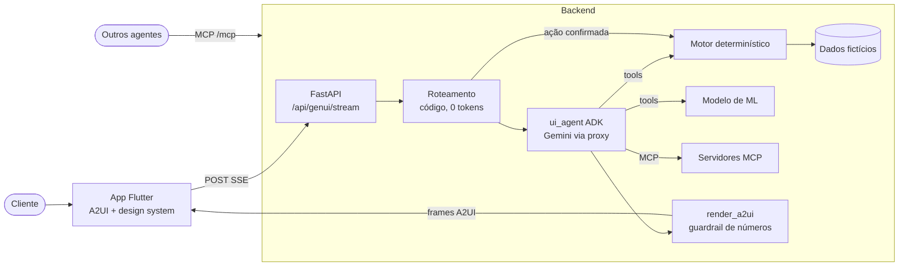
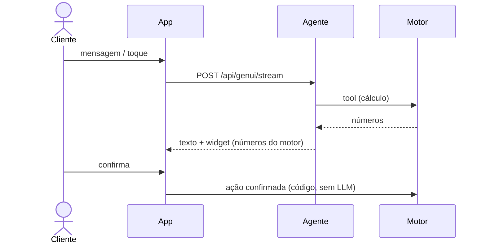

# <Nome do produto>: arquitetura

Padrões e mapeamento no repo: `.claude/skills/hackathon/references/arquitetura.md`.

## 1. Resumo em um parágrafo

<o que é, onde está a IA tradicional, onde está a generativa, o que o código calcula, o que o cliente confirma, que stack Google usa>

## 2. Princípios

| Princípio | Como se garante |
|---|---|
| O LLM nunca calcula | motor em `backend/app/modules/<dominio>/` + guardrail de números |
| Só o cliente confirma ação com efeito | card de confirmação + execução por código |
| Nenhum dado real de cliente | dados fictícios rotulados / dado do evento |
| Sem beco sem saída | toda resposta termina em próximo passo; humano é saída prevista |

## 3. Contrato do agente

| Pode | Não pode | Encaminha para humano quando |
|---|---|---|
| | | |

## 4. Visão geral (C4 níveis 1 e 2)

## 5. Componentes

| Componente | Responsabilidade | Onde no repo |
|---|---|---|
| Motor | | `backend/app/modules/<dominio>/service.py` |
| Modelo de ML | | `backend/app/modules/<dominio>/ml.py` |
| Tools do agente | | `backend/app/modules/<dominio>/tools.py` |
| Instrução e few-shots | | `backend/app/modules/assistant/agent.py` |
| Roteamento / execução confirmada | | `backend/app/modules/assistant/workflow.py` |
| Widgets | | `contracts/`, `mobile/lib/modules/<dominio>/` |
| MCP | | `MCP_SERVERS`, `/mcp`, `backend/mcp_servers/` |

## 6. Integrações Google

| Serviço | Para quê | Status (real / simulado) |
|---|---|---|
| Gemini via proxy | | |
| ADK 2.x | | |
| BigQuery / BigQuery ML | | |
| Cloud Run | | |

## 7. Fluxos principais

## 8. Decisões técnicas

| # | Decisão | Por quê | Alternativa descartada | Onde |
|---|---|---|---|---|
| D1 | Motor determinístico separado do LLM | exatidão, testes | LLM calcular | |
| D2 | Ação com efeito executada por código após confirmação | segurança, consentimento | LLM decidir | |

## 9. Decisões de dados e algoritmos

Detalhes em [`06-dados.md`](06-dados.md).

| # | Decisão | Por quê | Onde |
|---|---|---|---|
| A1 | | | |

## 10. Segurança, privacidade e IA responsável

- Dados: 
- Regulação (suitability, recomendação):
- Guardrails (entrada, tool, saída) e testes de ataque:
- Consentimento e revogação:

## 11. Qualidade e operação

- Testes (quantos, o que cobrem):
- Bateria de avaliação do agente:
- Custo por jornada e latência:

## 12. Limitações e evolução

- Simulado hoje:
- Para produzir:

## 13. Rastreabilidade

| Requisito / promessa do pitch | Arquivo | Teste |
|---|---|---|
| | | |
